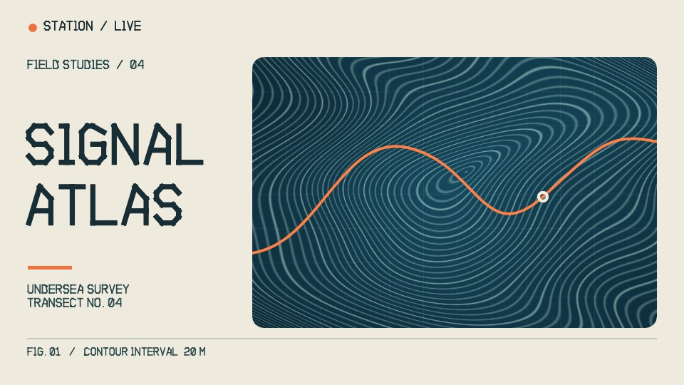

# N4

N4 is a native video editing engine incubating in [Grida’s nothing project](https://github.com/gridaco/nothing). A film is a directory of text files and assets. Change a shot, scrub to its frame, or render the edit to MP4. The Rust engine owns the picture, timeline, selection and edit history. The CLI, native viewer and Electron development host consume the same project.

Development takes place on the **`spikes`** branch. This is a contributor alpha for Apple Silicon Macs with Metal. The authoring format and host protocol evolve together.

[](spikes/examples/signal-atlas/preview.mp4)

## Run the first film

Install the Xcode command-line tools, [Rust via rustup](https://rustup.rs/) and Homebrew. To get the contributor branch and open its first film:

```sh
git clone --branch spikes https://github.com/gridaco/n4.git
cd n4
brew install just ffmpeg sdl2 webp
just demo
```

This builds the native viewer and opens **Signal Atlas**, an eight-second motion graphic with editable layers, a shared sequence, camera cuts and sound. Drag the timeline to scrub and press Space to play. To render it without a window, choose a new output filename.

```sh
just host-native
spikes/engine/target/debug/n4 validate spikes/examples/signal-atlas
spikes/engine/target/debug/n4 export spikes/examples/signal-atlas --out /tmp/signal-atlas.mp4
```

**Field Unit** adds a camera, a hinged 3D instrument and an animated display. Its USD import uses the optional OpenUSD SDK. Both projects include their source artwork and asset provenance. [Example catalog](spikes/examples/README.md) · [OpenUSD setup](spikes/spatial/openusd/PROFILE.md#local-sdk-and-tests)

To make your own film with an agent, copy Signal Atlas to a new directory and start the agent there. Its project guide names the editable layers, timing and frames to review. [Agent entry point](llms.txt) · [Template instructions](spikes/examples/signal-atlas/AGENTS.md)

## Where to start

| If you want to… | Start here |
| --- | --- |
| Write or generate a video project | [Project and sequence format](docs/project-format.md) · [Python authoring SDK](spikes/sdk/python/README.md) |
| Inspect a frame, pick a layer or persist a track edit | [Headless editor contract](spikes/rfcs/0008-editor-session.md) |
| Embed N4 in a desktop host | [Electron kit and harness](spikes/host/README.md) |
| Change the engine or qualify a new capability | [Specs and design decisions](docs/README.md) · [Contribution guide](CONTRIBUTING.md) |

Engine code and documentation use [Apache-2.0](LICENSE). Public example films and test media carry a [CC0 dedication](LICENSES/CC0-1.0.txt). See the [asset policy](docs/assets.md) before adding media.
