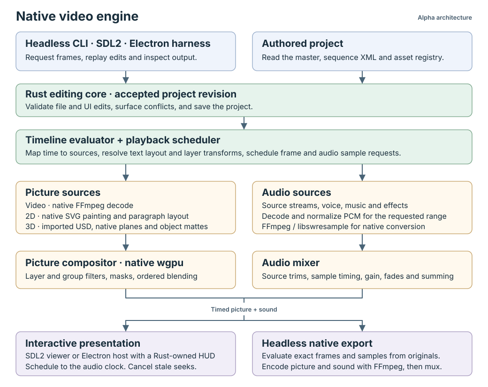

# Native video engine architecture

Alpha architecture. The standalone Rust engine owns project evaluation, decoding, the native GPU device, composition and export. The native CLI renders explicit project frames on an offscreen GPU target. The SDL2 player exercises native input, display and audio. The [Electron harness](../../../host/README.md) drives the same Rust host contract. The [technical research](technical-research.md) records the candidate libraries and integration questions. The [creator brief](creator-expectations.md) defines the release expectations.

The [rendering pipeline proposal](rendering-pipeline.md) traces a frame through decoding, 2D painting, filters and presentation, including the seek scheduler, thumbnail jobs and engine probes.

For changes to this architecture, use the [primitive and ownership review](reference-authoring-plan.md#how-a-capability-earns-a-primitive-and-an-owner). Trace the requested edit from the persisted document to evaluation and presentation. Where the current interface loses information the creator needs, specify the boundary change, migration and acceptance edit together.

## What the engine owns

| Component                          | Input → output                                                                      | Responsibility                                                                                                                                                                                                                                                                                                          |
| ---------------------------------- | ----------------------------------------------------------------------------------- | ----------------------------------------------------------------------------------------------------------------------------------------------------------------------------------------------------------------------------------------------------------------------------------------------------------------------- |
| Editing core                       | File revision or edit batch → validated project revision                            | Resolve addresses for the entities a command edits. Validate the batch and preserve its authored meaning across save, reopen and undo. The fixture exercises identity across edits; the public naming and serialization policy can evolve.                                                                                                                                        |
| Timeline evaluator                 | Revision + project time or sample range → picture and sound plans                   | Resolve clip ranges, nested time maps, trims, layout, property curves, compositing order and audio automation. A temporal effect can request several source frames for one output frame.                                                                                                                                |
| Playback scheduler | Plans + audio clock or requested seek time → bounded work queues | In the native engine, decode ahead during playback, prioritize the latest scrub request and discard stale work. Queue finished frames for presentation. A host supplies transport commands and observes frame identity and playback status. Offline scheduling evaluates every required frame and sample. |
| Source providers                   | Source identity, local time/range, scale and quality → image surface or PCM         | Read footage, draw a 2D graphic, or retrieve a linked composition's approved render. Carry dimensions, color interpretation, timestamps and alpha convention with picture. Carry sample rate and channel layout with sound.                                                                                             |
| Picture compositor and audio mixer | Resolved inputs → composed picture and timed audio blocks | Native Rust owns the wgpu device and executes transforms, masks, blends and multi-input effects. The native mixer applies sample-range edits, gain and fades. Preview and export share these paths and may use different queues or quality settings. |
| Asset and job service              | Asset reference + request → metadata, proxy, thumbnail, waveform, or rendered media | Probe originals with FFmpeg, track proxy-to-original time mapping, and serve cached thumbnails by visible range. A cache miss may cost time. A missing source remains an identifiable, relinkable project object.                                                                                                       |
| Export service                     | Pinned project revision + output profile → deliverable file                         | Resolve originals, drive the compositor and mixer at explicit times, encode and mux. First candidate is Rec. 709 H.264/AAC MP4. Inspect the delivered file independently of the preview.                                                                                                                                |

## What should survive a format rewrite

The fixture reader translates authored syntax into a validated composition. Evaluating one revision at an explicit time yields concrete source-time requests and ordered picture operations, or audio sample ranges for a mix. The executor deals with decoded media, surfaces, color, alpha and lifetimes. Its inputs carry the meaning of the work, independent of how the creator spelled the clip or arranged project files. Keep these as private Rust boundaries until a second consumer makes a public contract worthwhile.

For a regression, construct a small composition directly in memory and load the equivalent from fixture text. At a nested cut compare the requested source times, paint order, pre-encode pixels and mixed sample range. A syntax rewrite that preserves the edit should pass the same checks. A change to the meaning of a trim or effect can legitimately change the plan and deserves an explicit new expectation.

## Picture sources and filters

The proposed v1 stage has fixed dimensions. A text box shapes and wraps its own text. Each layer has a placement and can animate independently, including within a transformed group. The evaluator can resolve these properties at a requested time without introducing sibling flow or responsive layout.

The compositor requests pixels from the sources each edit needs. A decoder supplies a video frame, a painter supplies text or path artwork at the requested scale, and a linked composition supplies its approved render. The compositor respects authored stacking order even when two graphics surround a video layer. For a filter on one layer it samples that layer. For a filter on a group it composes the children first. A group may need a temporary surface for this step. The editable children and their cached inputs survive.

The proposed project contract records an ordered filter reference and its parameter values or curves. A bundled dry-ink filter and a creator's own filter use the same mechanism. Their definitions supply the controls and defaults that the inspector and script can discover. The compositor defines image coordinates, color and alpha conventions. A filter declares any extra inputs or output area it needs, such as the space an outline extends beyond the source. Each new look can ship independently of the project schema.

Prototype the image-filter interface with WGSL. The same filter should run on footage, a painted surface, and a mixed group. A painter can use Skia runtime effects internally when it needs information available while drawing. For example, a directional brush may need distance along an editable path, which the painter can calculate before rasterization. SkSL stays private to the painter across project files, SDKs and plugins. The permanent compositor shader interface and any geometry-aware brush interface remain open. [Text effect boundary](rendering-pipeline.md#effects-on-editable-type) · [WGSL](https://www.w3.org/TR/WGSL/) · [Skia runtime effects](https://skia.org/docs/user/sksl/)

## Where extensions and the editor client meet

The timeline owns placement, ordering and time mapping. A source can supply picture at source time or sound over a sample range. A clip is one use of that source with its own trim and placement. An inline composition contains editable children. Multiple clips can reference a named composition when a change inside it should reach every use. These distinctions also support the [editorial handoff described in the design inventory](design-precedents.md).

The editor reads the same authored text a person or agent can edit directly. Validate a changed file before replacing the live revision. When an external patch and an unsaved GUI edit overlap, retain both and show the conflict. A CLI or SDK can inspect the parsed model or submit structured edits. The layer hierarchy, timeline and inspector derive from the accepted project, including while an extension is unavailable.

A proposed source extension could expose a camera parameter and fulfill picture requests from an approved render. Two placements could request different source times. A thumbnail could use a reduced-size picture request. A public provider contract would need rules for deterministic access, dependencies and capability discovery.

## How a single edit travels

In the current editor, toggling root V2 changes track visibility in the accepted revision. Rust reports the affected time intervals and redraws the parked frame if necessary. Undo and redo operate on the same document history. Saving writes the master and a later open recovers the edited visibility. Editing title content through an external XML save uses the revision and damage path as well. [Headless editor checks](../../../engine/tests/editor_tracks.rs) · [Reload checks](live-edit-demo.md)

## What each host can prove

- **Render and inspect headlessly.** FFmpeg supplies timestamped source frames to the offscreen native compositor. Request a known frame from a fresh CLI process, seek away and back, then inspect source IDs, pixels and exact sample ranges. Record native frame readiness and memory.
- **Paint and composite.** Reuse a cached transparent surface when an overlay moves. Repaint when its text changes or it needs greater resolution. Measure painting and upload separately for the Skia-backed artwork provider. A frosted panel needs the background as an input to the compositor.
- **Export composed frames.** From the headless CLI, open the production, composite originals at explicit frame times and encode the master through native FFmpeg. Compare the CLI's pre-encode pixels with full-quality inspection at the same revision, time and size. Time the GPU-to-encoder transfer separately.
- **Measure real presentation and audio.** Open the SDL2 player on the target Mac, repeat a seek and a text-width edit through the same engine, and compare revision and frame ID to the CLI. Time physical input, the first control feedback, native frame readiness and screen presentation separately. Listen at the sync marks. Headless replay covers render correctness; the window and audio device supply evidence about interaction and pacing.
- **Inspect product interaction.** TypeScript maps host pointer events and draws the timeline. Rust resolves document hits, owns the selection and renders the preview HUD. A windowless client can issue the same intents and inspect the resulting state. [Editor contract](../../../rfcs/0008-editor-session.md)
- **Qualify frame transfer in Electron.** Its experimental texture import is one candidate for displaying a completed native frame. Compare actual copies, synchronization, color and latency with a bounded copy path on the shipping host. Consider an earlier isolated handoff test only if a delivery decision depends on that result. [Electron shared textures](https://www.electronjs.org/docs/latest/api/shared-texture)
