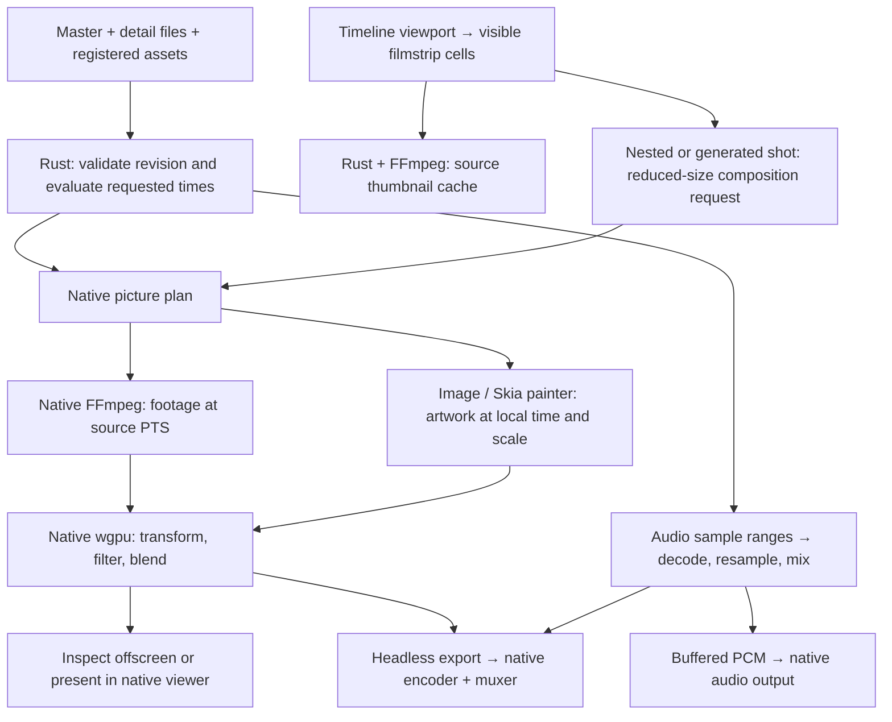

# Rendering, seeking and filmstrips

Use the [public examples](../../../examples/README.md) and [regression guide](../../../../docs/tests.md) to distinguish the implemented path from the scheduling and transfer proposals below.

**Engine boundary.** A standalone native Rust engine opens the project, schedules media, owns the native wgpu device and renders the finished picture and audio. A headless CLI drives offscreen frame inspection, edit replay and movie export. An SDL2 diagnostic player presents the finished frame and measures playback on the target Mac. The Electron harness sends input through the same native session and consumes Rust-owned state and HUD output. The [PoC gates](poc-gates.md) define the measurements for accepting a path.

## How an edit becomes pixels

1. **Prepare a revision.** Lower the provisional master and detail definitions into a validated revision once per accepted edit. The evaluator also accepts compositions built directly by tests. Index intervals by sequence and lane, resolve named inputs, and cache curve and text-layout data. Prepare short windows of picture plans ahead of playback. A seek starts a new window at the requested frame. Run picture planning and playback inside the engine. During windowed playback the viewer presents the completed frame and releases it after use. Offscreen jobs release their own frame references after comparison or encoding.
2. **Evaluate a time.** Input is a revision, episode frame, output size and quality profile. Descend only into active placements, mapping parent time through source trims and local clocks. Evaluate properties at that time. Produce operations such as sample a stream at a presentation timestamp (PTS), draw a glyph run, filter a named surface, or blend two inputs. The plan can be inspected without a GPU. An audio request takes a sample interval on a separate clock.
3. **Resolve and composite.** Each input provider supplies a surface, its bounds, timestamp where applicable, color interpretation and alpha convention. Walk authored paint order. A group with opacity, masking or a group filter may need a temporary texture so the operation applies once to its combined children. Reuse pooled textures once the GPU has finished using them.
4. **Present or encode.** Render to an owned working surface. A headless request can inspect its pixels and revision directly. A native viewer presents the finished image in its SDL2 window with diagnostics drawn separately. The renderer can reuse an offscreen texture after its last consumer finishes. Export pins the project and asset revisions, drives exact output times from originals and sends frames and offline-mixed PCM to FFmpeg. For the first export, use bounded GPU readback and an explicit color conversion to SDR Rec. 709 H.264/AAC MP4. Measure this path before optimizing it. If readback dominates export, test a native encoder surface handoff against the same fidelity checks. Run this export without a window or audio device.

### A frame with two real editorial dependencies

At project frame 76 in Signal Atlas, the inspector can reach a signal lamp four frames into its animation inside the nested sounding shot. The V1 placement and A1 soundtrack each use their own source clocks. Evaluate the same frame from a fresh open and after visiting the reprise. The parked picture and audio slice should agree. [Project and inspection exercise](../../../examples/signal-atlas/README.md)

## Playback and seek

During playback, prebuffer audio and picture. Use the audio output clock mapped to the project playhead as the timing reference; use a monotonic clock when playing silently without an audio device. Present the picture due at that time. Bound queues by both frames and bytes. If picture falls behind, advance to the due presentation frame and record the miss. Preserve audio continuity. Keep dependency decoding for interframe codecs even when a late decoded frame will never be displayed.

For a seek or scrub:

1. Take the newest playhead target and increment a seek generation. Resolve every contributing clip, including transition handles. The basic lookup is the source frame whose presentation interval contains the mapped time. Use media timestamps for variable-frame-rate recordings. Account for track start offsets, gaps and the exclusive end.
2. Try the decoded-frame cache. For nearby forward requests, keep decoding from the existing session. For a distant or backward miss, move the demuxer to a usable random-access point at or before the target, reset/reconfigure the decoder as required, and feed packets forward in decode order. Select output by presentation time. Cache a bounded neighborhood for reverse drags. Check timestamp selection through the native decoder. [FFmpeg demux and seek API](https://ffmpeg.org/doxygen/trunk/group__lavf__decoding.html)
3. Coalesce pointer moves. Gate publication on the active revision, generation and requested time. Release discarded frames. While dragging, a labeled proxy/draft can give fast feedback. On release, settle on the exact frame, request inspection quality, and rebase the audio queue and clock before resuming. A proxy needs a verified mapping to original PTS.

## Timeline thumbnails

The UI requests cells in its visible time range at a pixel size and zoom level, plus a small margin. Sample each cell at a defined instant inside the visible placement, then apply its trim and time mapping. A footage filmstrip shows **source frames**. A nested sequence or generated graphic shows its **own composed result** at the mapped local time. These choices keep neighboring tracks and editor controls out of a clip's thumbnails.

For ordinary footage, use a bounded Rust/FFmpeg job with a separate decoder context. Deduplicate identical samples, sort nearby times by source, decode forward in batches, then resize and cache the small images. Return thumbnail results with request and source identity. A headless workload can advance the visible range and cancel outstanding requests before a timeline UI exists. For a composed thumbnail, submit a low-priority request to the same compositor at thumbnail size. Background work yields to audio, playback and the current seek. A viewport change drops obsolete subscriptions; a completed job may populate the cache, but only the current cell binding may paint it. Compute audio waveforms separately as multiresolution PCM peaks.

Key a footage tile by asset content revision, stream, selected sample, proxy/original identity, orientation, color treatment and size tier. Two placements of the same source can reuse it. A composition tile also needs a fingerprint of its visible inputs, properties, filters, time and quality. Changing a title invalidates thumbnails depicting that title; the footage filmstrip underneath stays reusable. Use bounded memory for hot tiles and a rebuildable disk cache for cold ones.

## Video, image, SVG and text

| Source | First implementation | What an edit makes expensive |
| --- | --- | --- |
| Video | Demux and decode locally with FFmpeg. Select a frame by source presentation time. Qualify hardware decoding and surface import on the target Mac; measure a native upload path and indexed proxies on the same footage. | A jump across a long group of interdependent frames can require decoding multiple packets for one displayed frame. |
| Image | Decode once with orientation and color metadata, upload to a texture, sample through the authored transform. | Replacing the asset or needing a higher-resolution representation. |
| SVG | Use the supported SVG subset of a Skia-backed painter. Rasterize to transparent bounds at the required projected scale. | Path, stroke, or local animation changes require repainting. Moving a static drawing can reuse its texture. |
| Native path | Keep editable geometry in local units. Skia paints its fill and stroke or supplies a mask from filled coverage. Each cropped texture retains its local origin. | Editing geometry or paint changes the affected raster. Translating the layer or editing its WGSL strength reuses the upload. |
| Text | Shape and lay out the supplied font at the authored width; paint glyphs to a transparent surface. Use the same font bytes and layout for preview and export. | Changing text, font, or wrap width requires layout. A fade or translation can reuse its existing surface. |

Start with bounded transparent Skia pixel buffers uploaded on cache miss. That makes the cost observable on the existing [painter boundary](technical-research.md#graphics-layout-and-external-renderers). If repaint and upload dominate for dynamic artwork, try a GPU-backed painter interoperating with native wgpu. The viewer and the encoder consume finished frames separately. Measure copies, synchronization, release and surface reuse on each path. Qualify cross-process transfer on each Electron target. [Electron shared textures](https://www.electronjs.org/docs/latest/api/shared-texture)

### Native paths and mask ownership

N4 keeps the authored curve and can consume it in two ways. A path layer paints a fill and stroke. A geometric mask uses the filled coverage. The receiver places its mask in its own local coordinates. An imported SVG supplies its painted alpha through the same mask input and stays one asset in the composition. The current spike paints at one pixel per project unit. [Native Path implementation and acceptance checks](native-path-spike.md)

Group children establish paint order. The compositor combines them on an isolated surface, runs the group effect and applies the mask once to the result. Skia's cropped path raster carries its local origin, so changing its bounds preserves the coordinates passed to WGSL. The existing dry-ink shader runs on a path, an SVG, footage and an isolated group. The creator trial uses a single contour for a group mask and a separate visible stroke. [Compositor tests](../../../engine/src/render/gpu.rs)

A brush that follows a stroke needs distance along the curve and its tangent. The frosted card uses a different input. It samples the accumulated lower layers, including neighboring pixels beyond the silhouette. The native demo draws a revealing graphic behind the card and sharp text above it. These operations can use internal surfaces while the authored layer tree stays the same. [Godot Line2D](https://docs.godotengine.org/en/stable/classes/class_line2d.html) · [Unity Line Renderer](https://docs.unity3d.com/2022.3/Documentation/Manual/class-LineRenderer.html)

## Shader contract

The native frosted-caption trial runs the same sampled-image WGSL horizontally and vertically. The compositor supplies the scoped backdrop and replaces it through the card silhouette. A second WGSL function can animate coverage within the mask using timeline phase. Playback and export share both shaders. [Backdrop blur spike](backdrop-blur-spike.md)

The current point-effect hook takes drawable-local coordinates, one linear premultiplied color and an amount. Scene filters can also declare named object mattes. The sampled backdrop and shadow passes can read neighbors within a bounded directional footprint. The backdrop mask has a separate time-driven coverage hook. These WGSL interfaces are private spike contracts. For a general filter, the proposed contract would describe named source and backdrop inputs, any neighboring frames, coordinate space, output padding and animated parameters. Bind explicit sample time and seed for time-varying noise, and include input revisions and the effect implementation in cache keys. A project-specific effect and a bundled effect should use the same compositor inputs. [Point-effect call](../../../engine/src/render/overlay.wgsl) · [Sampled filter](../../../engine/src/render/gpu/sampled.wgsl) · [Current filter definitions](../../../engine/src/graphics.rs)

A filter on `<scene3d>` can request up to eight scalar mattes from USD placements and native text planes in that scene. Each declaration generates a WGSL accessor such as `matte_word(pixel)`. Coordinates are integer pixels in the projected scene with a top-left origin. Each lookup returns coverage from zero to one, or zero outside the image. The author chooses a projection or a depth relationship. [Matte declarations and validation](../../../engine/src/graphics/spatial.rs)

| Authored input | Coverage at a sample |
| --- | --- |
| `<matte name="word" object="title"/>` | The projected glyph covers the sample, including parts hidden by other objects. Holes in a letter remain clear. |
| `<matte name="ink" object="title" coverage="visible"/>` | The glyph covers the sample and wins the scene’s depth test there. |
| `<matte name="hidden" object="title" occluded-by="ribbon"/>` | The glyph covers the sample and the ribbon wins the depth test there. A third object in front suppresses this relationship. |

The spatial pass evaluates coverage with the same camera, time and sample positions as the scene color. Visible and occluder-qualified mattes use the winning object at each sample. Each requested matte resolves to one texture-array layer. Existing color-only scenes skip the matte passes. The shader receives coverage values through the declared names. Material parameters, arbitrary USD descendants and scene depth would each require their own inputs. The overprint uses neighboring samples of the complete word to find its edge, then uses the hidden matte to print that edge on the ribbon. [GPU passes](../../../engine/src/render/gpu/spatial.rs)

For dry ink, sample a paper-grain texture in the chart's own coordinates and use it to reduce coverage on the axis. With premultiplied input, multiply both RGB and alpha by the coverage. Moving the chart moves the grain with it. Applying that same pass to a video or to an isolated group exercises the common surface interface. A geometry-aware brush needing distance along a path belongs in the painter, where that information exists. [Skia runtime effects](https://skia.org/docs/user/sksl/) · [WebGPU shading language](https://www.w3.org/TR/WGSL/)

Specify the surface contract before shipping custom shaders. For the SDR trial, use linear-light Rec. 709 primaries, premultiplied alpha and an RGBA16F working texture where supported. At ingest, honor source range, transfer and primaries, accounting for any conversion already performed during decode or native surface import. Convert once to each output's declared encoding. Declare filter bounds/padding for effects such as an outline or blur. Declare time offsets for a temporal effect so a direct seek can request the samples it needs. The first custom-filter trial can use a stateless, single-pass effect. Persisting arbitrary GPU state across playback frames would need a separate random-access contract.

### Effects on editable type

The title stays editable as copy, font, wrap width and range animation. Today Skia shapes the paragraph and paints it onto transparent pixels. The compositor can use the alpha of opaque painted letters as an antialiased silhouette. A grainy dissolve can thin that silhouette. A soft glow or a bevel-style highlight can use neighboring coverage at the rendered size. Allow room around the letter for the glow, and recompute coverage at the target scale when a zoom exposes more detail. These are candidates for image effects and still need a title-specific picture check. The existing frosted-caption proof places sharp text above its filtered backdrop. [Text raster and range tests](../../../engine/src/render/text.rs)

For lettering whose appearance reacts to footage, the compositor needs the moving picture already painted below the title in its group. A blend mode uses source and backdrop colors at the same position. A refractive title needs nearby backdrop samples and the title silhouette to delimit the treatment. To prove the distinction, move a stripe behind the lettering, then move the stripe above it. Check the letter counters, translucent edges and unaffected foreground at the same frame in preview and export. Timed grain can be reproduced from sample time and a seed. A trail intended to reproduce earlier pictures also needs those pictures at their declared times. [Compositing and blending](https://www.w3.org/TR/compositing-1/#blending) · [Native backdrop implementation](../../../engine/src/render/gpu/backdrop.rs)

To stagger an effect by letter, retain the mapping between source text ranges and shaped glyph clusters before painting. To animate a glyph contour, request geometry from the text provider when that authoring case is demonstrated. A finished RGBA title has already combined overlapping glyphs and lost their identities. The existing range animator uses the provider's cluster mapping internally. Public project files, SDKs and plugins refer to N4 effect inputs and controls. SkSL stays private to the painter. A future text backend can supply equivalent coverage and shaped ranges while the authored effect remains intact. [Text range evaluator](../../../engine/src/graphics/text_animation.rs) · [Skia runtime effects](https://skia.org/docs/user/sksl/)

## First engineering tools

- **Explain a frame.** For a given revision and episode frame, print nested times, active placements, requested source times, cache keys/hits and ordered passes. Use the Signal Atlas nested sounding sequence. Check the adjacent frames against the keys in its detail file.
- **Replay a seek under load.** Use long-GOP footage and a VFR capture with identifiable frames, known timestamp intervals and separate audible sync marks. Issue forward jumps, reverse drags and rapid A → B → A seeks while scrolling the filmstrip. Record request generation, requested/presented frame IDs, latency, discarded work, peak live surfaces, missed deadlines and audio underruns.
- **Compare a frame.** From a pinned revision, capture the paused inspection surface and the export surface before compression. Match resolution, inputs, sample pattern, working color and shader settings. Verify the encoded movie independently for timestamps, color, soft edges and sync. A paper timeline test can verify source requests; offscreen pixels and codec behavior need the native engine, while actual presentation requires a windowed run.

Use the [existing P0–P8 gates](poc-gates.md) and their recorded machine and load profile. First render real footage, a wrappable paragraph and a mask by frame number with the native CLI. Retime an edit, seek backward, compare the result against a fresh process and export headlessly. Retain the independent cue sheet and regression assertions as the format evolves. Use the native viewer to measure input-to-display latency, refresh pacing and audio output. Benchmarking native presentation cannot establish performance of a future Electron frame handoff.
