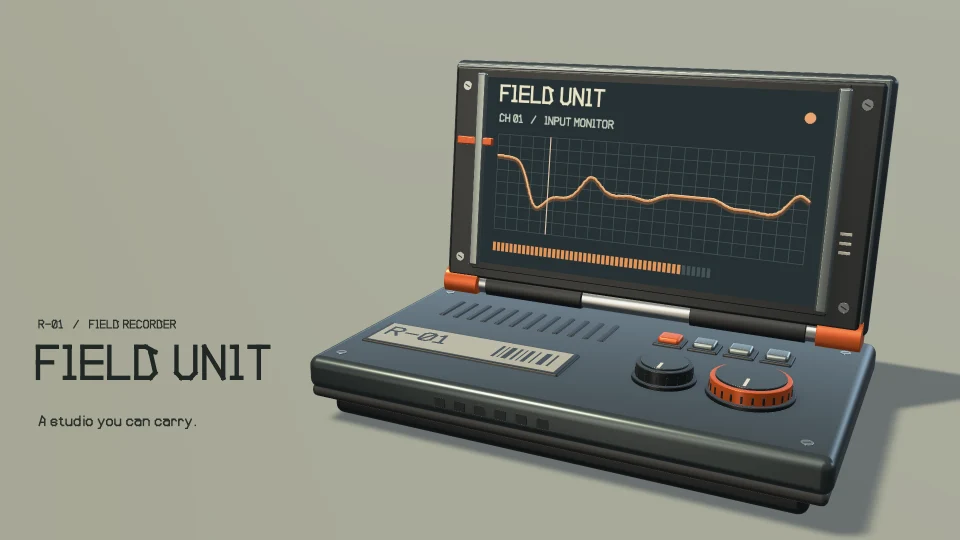

# Field Unit



A six-second product spot for a fictional field recorder. The first camera sees the lid open. The second moves close enough to read the live oscilloscope. The final cut returns to the whole instrument. The model, signal, lettering and sound are editable independently. [Watch the exported film](preview.mp4).

From the repository root on a Mac with Metal, FFmpeg and the [OpenUSD SDK](../../spatial/openusd/PROFILE.md#local-sdk-and-tests) installed, run the inspector.

```sh
just inspect spikes/examples/field-unit
```

- **Watch the cut.** Scrub across frame 50 or 101. The camera and screen content are defined on different clocks. The signal continues across both cuts. [Timeline](project.proj)
- **Change the shot.** Edit the hinge angle at frame 47 or the printed model number in the shot XML. Watch the recorder’s guard occlude the moving display artwork. The screen uses an unlit material slot. The serial plate responds to lighting. [Instrument shot](sequences/instrument.xml)
- **Change the titles.** Adjust the screen-space imprint while keeping the recorder and its material artwork fixed. [Title sequence](sequences/imprint.xml)

## Asset sources

The project authors dedicate the project files, model, artwork, typeface and sound supplied here to the public domain under [CC0 1.0](../../../LICENSES/CC0-1.0.txt). Each input has a local source.

| Asset | How it was made |
| --- | --- |
| `assets/field.usdc` | The original Blender model builds the enclosure, fasteners, hinge, monitor and printed plate from geometry in Python. It exports a rigid USD stage with no external mesh or texture dependencies. [Model source](author/device.py) |
| `assets/signal.mp4`, `assets/score.wav` | The authoring script draws a sampled waveform and grid for each picture and synthesizes a stereo tone bed and switching transients. [Media source](author/media_sources.py) |
| `preview.mp4`, `preview.webp` | Full six-second N4 export with synthesized sound and a 960×540 still from frame 142. |
| `assets/N4GridSans.ttf` | Original grid lettering drawn for N4. The example contains a local copy so the project directory can be moved as a unit. [Font source](../../engine/fixtures/fonts/build_font.py) |

All playback assets are included. To rebuild the media, run `python3 author/media_sources.py` with NumPy, Pillow and FFmpeg (libx264) available. To rebuild the model, run `blender --background --factory-startup --python author/device.py` from this directory. The supplied export was made with Blender 5.2 LTS.
