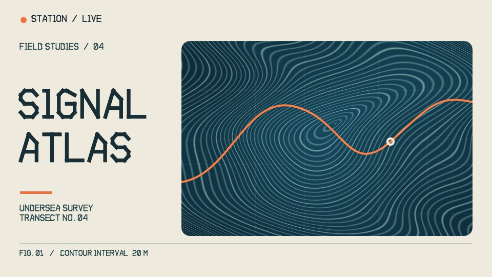

# Signal Atlas

An eight-second motion study of a fictional seafloor survey. An orange transect crosses a contour plate, cuts to an echo profile, then returns to the same plate through a tighter camera. The native composition runs at 960 × 540 and 24 fps. [Watch the exported film](preview.mp4).



## Use it as a template

From the N4 checkout, build the CLI once and copy the entire project. The editable files, media and [agent guide](AGENTS.md) travel together.

```sh
just host-native
export N4_BIN="$(pwd)/spikes/engine/target/debug/n4"
work=$(mktemp -d)
cp -R spikes/examples/signal-atlas "$work/my-film"
cd "$work/my-film"
"$N4_BIN" validate .
"$N4_BIN" inspect .
```

Start by changing the film title or retiming the orange survey line. The [editing guide](AGENTS.md) identifies both controls and the frames to compare. New exports can live anywhere your process can write.

## Open the original

From the N4 checkout:

```sh
just demo
just viewer spikes/examples/signal-atlas --frame=42
```

- At **frame 42**, select the contour plate, its rounded mask area, the cream station symbol or the title. Edit the path in [survey.xml](sequences/survey.xml) and save. The first and last shots share that definition.
- At **frame 76**, inspect the opacity key on **Sounder → Instrument → Signal lamp**. Its layer-local frame is 4, eight frames after the start of the nested sequence plus four frames into the animation.
- Toggle **V2** to remove the station indicator from frames `[0,56)` and `[128,192)`. The middle sounding shot is unaffected. Undo restores both occurrences.
- At **frame 142**, the second survey placement uses its own camera cut. The composition and camera schedule are visible in [project.proj](project.proj).

## Asset provenance

The project, imagery, type and audio are original N4 example work, dedicated to the public domain under [CC0 1.0](CC0-1.0.txt). No recorded footage or geographic survey data are required.

| File | Origin |
| --- | --- |
| `assets/relief.png`, `assets/echo.svg` | Contours and chart strokes derived from mathematical functions in [generate.py](generate.py). |
| `assets/pings.wav` | Six original synthesized pings, mono 48 kHz PCM. The A1 edit splits the same recording at frame 128. |
| `assets/station.svg` | Hand-authored ring with a transparent center. |
| `assets/N4GridSans.ttf` | Original N4 Grid Sans, generated from glyph strokes. The drawing source is `spikes/engine/fixtures/fonts/build_font.py` in the N4 checkout. |
| `poster.jpg`, `preview.mp4` | Frame 42 and the full film rendered from this project by N4. |

The source media are checked in. From the project folder, run `python3 generate.py` to regenerate the contours and pings. To export an edited film after following the template setup, choose a new output path.

```sh
review=$(mktemp -d)
"$N4_BIN" export . --out "$review/film.mp4"
```
